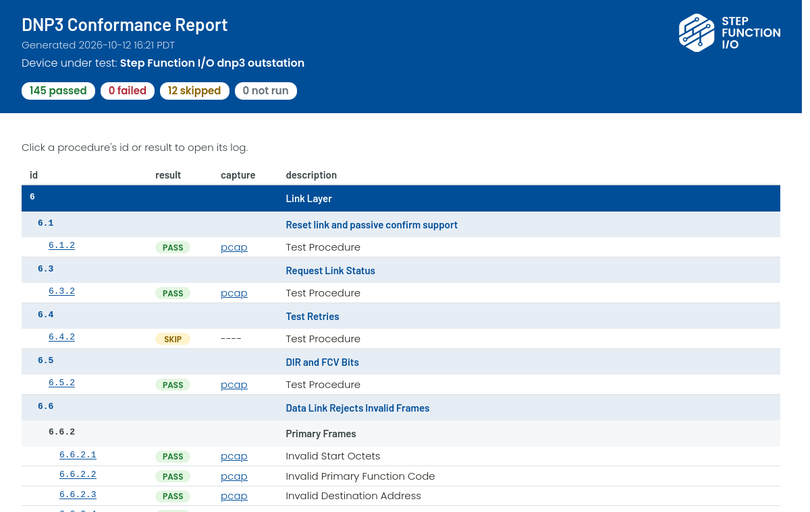
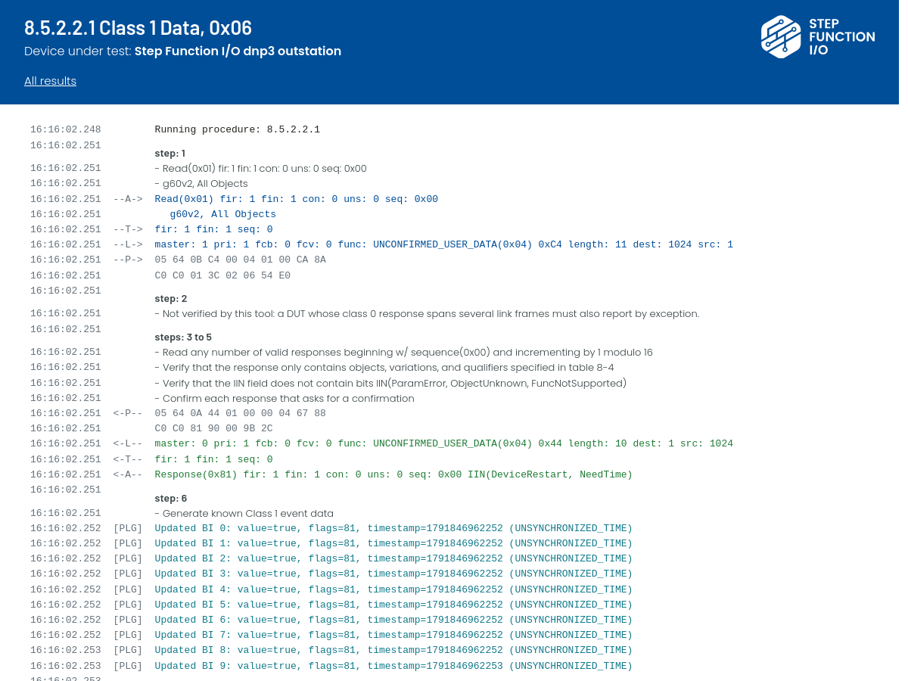

# dnp3c

A DNP3 conformance test harness from [Step Function I/O](https://stepfunc.io). It runs the outstation test procedures of the DNP3 IED Certification Procedure, versions 3.1 rev 1 and 2.7, against a device and produces an HTML report of the results.

dnp3c can be used in two ways:

- **As a command-line tool**, for testing a device by hand. Steps the harness can't perform over DNP3, such as cycling power or generating events, are prompted for.
- **As a library**, for automated testing, e.g. in CI. You implement `IntegrationPlugin` to perform those steps on your device and run the procedures with `io.stepfunc.dnp3c.conformance.Harness`.


*Section 8.5 (Class Data) run against the outstation of the [dnp3](https://github.com/stepfunc/dnp3) library, by the conformance tests its CI runs. Their `IntegrationPlugin` generates the events that a tester would otherwise generate by hand.*

## The report

Commercial DNP3 test tools save their results in proprietary formats. dnp3c writes plain HTML and pcap files:

- **The report is a web page.** It shows every procedure with its result, and it opens in any browser. You can archive it, email it, or publish it next to a release, and nobody needs a license to read it.
- **Every result can be traced.** Each procedure links to a log of every step, every frame it sent and received, decoded at each layer, and every check with its outcome.
- **The traffic is in Wireshark's format.** With capture on, each procedure's traffic is saved as a pcap that opens in Wireshark, decoded as DNP3.





## Test procedures

dnp3c implements two revisions of the DNP Users Group's *DNP3 IED Certification Procedure*, chosen with `-rev` (`-revs` lists them):

- **3.1 rev 1** (`3.1r1`, 13 September 2022) covers Subset Levels 1 to 3. Its tests have the numbers it gives them. One it leaves without a number has its section's number followed by a letter for its place among the section's unnumbered tests, e.g. 8.6.5b for the second; if it's the section's only test, it has the section's number and title, e.g. 8.6.1 Restart.
- **2.7** (`2.7`, 2 March 2016) covers Subset Level 2. Where a technical bulletin replaces a 2.7 test outright, dnp3c runs the replacement: TB2017-001's 8.6.4.2 and 8.6.4.3, whose steps are numbered 1.a, 1.b, and so on.

The section, procedure and step numbers in the tool, its logs and the report are those of the revision being run. Each revision is run as published, so a result under 2.7 can differ from one under 3.1 rev 1, which changes what some tests send or accept, often to apply technical bulletins published after 2.7.

### Where 3.1 rev 1 contradicts itself

3.1 rev 1 is inconsistent about how a device answers a read of a point type it has no points of. Its Table 11-1, and TB2016-001, which it follows, say the device answers with an error, IIN2.1 or IIN2.2. Table 11-1 also marks the update of the other affected sections as still to be done, and some of their steps still expect a Null Response, which has no error bits. So, as printed, the answer depends on the point type: a device without double-bit inputs must answer a read of g3 with an error, but one of g4 with a Null Response.

dnp3c resolves this the same way for every point type. A device without the points, or with them uninstalled or disabled for the test, answers with a Null Error Response: no objects, IIN2.1 or IIN2.2 set, and IIN2.0 clear. A device with the points but no events still answers a read of the events with a Null Response. The subset parsing tables of TB2016-003b say the same. This only changes which IIN bits a 3.1 rev 1 run accepts, not interoperability: a device certified against 2.7, which accepts the plain Null Response, is just as valid. 2.7 keeps its own steps.

| Test | As printed, for a device without the points | What dnp3c accepts |
|---|---|---|
| 8.3.2 | a Null Response, IIN2.1 or IIN2.2 optional (8.3.1 requires the error) | the error |
| 8.13.2b, 8.21b | an error response with IIN2.1 or IIN2.2, which may carry data | the error, with no data and IIN2.0 clear |
| 8.14.2b, 8.17.2b, 8.19.2b, 8.22b | a Null Response | the error; with the points but no events, a Null Response, as printed |
| 8.22.1 | a Null Response, IIN2.1 or IIN2.2 optional (8.21.1 requires the error) | the error |
| 8.23.2.x.1 | an error response with any error bit | the error, IIN2.0 clear; IIN2.0 still passes where a level 1 or 2 device without range reads leaves the test |
| 8.24.2a–g | a, c–e and g read the type and accept the error; b and f skip a device without it | all seven read the type once and require the error |
| 8.25.2c–e | the error, though 8.25.1 also allows a Null Response | the error; with the points but no events, a Null Response or IIN2.1, as 8.25.1 allows |

A level 1 test of a device that can't read a type (8.13.2a and the like) runs only for a device that has the type; a device without it gets the test above instead.

## Requirements

Java 17 or newer.

## Command-line tool

Download `dnp3c-<version>.zip` from the [releases](https://github.com/stepfunc/dnp3c/releases), unzip it, and run `bin/dnp3c` (`bin\dnp3c.cmd` on Windows). The launcher uses the Java in `JAVA_HOME`, or on the `PATH`, and tells you if it's missing or too old.

```
dnp3c -write device.ini                          # write a configuration file with every option
dnp3c -revs                                      # list the revisions of the test procedures
dnp3c -rev 2.7 -config device.ini -run all       # run every procedure and write the report
dnp3c -rev 2.7 -config device.ini -describe 8.23 # print the steps of a section or procedure
dnp3c -rev 2.7 -help                             # list the commands and test sections
```

Results, including `report.html`, are written to the revision's folder of the directory set by `test.output.directory`, e.g. `results/2.7/L2/`. The configuration must set `outstation.subset.level`, the DNP3 subset level the device is configured for: it has no default. See [Testing a device by hand](docs/manual-testing.md) for the whole workflow.

A procedure the device can't pass yet, e.g. for a known gap, can be excluded in the configuration, with the reason: `test.exclude.3.1r1.8.26.2 = Assign Class isn't supported yet`. It isn't run, and the report shows it as not run, with the reason, apart from skipped procedures, which don't apply to the device. Each exclusion names its revision, so one configuration can carry exclusions for several revisions. See [Exclude procedures](docs/manual-testing.md#exclude-procedures).

## Library

The library jar, `io.stepfunc:dnp3c`, is published to Maven Central. See [Automating the tests](docs/automation.md) for writing an integration plugin and running it in CI.

## Known limitations

- **Not implemented** in 2.7: 8.10.2 (multi-drop support) and 8.12.2 (collision avoidance). The report shows them struck through.
- **3.1r1's 8.12.2** (collision avoidance) runs over serial, and times the device's answers on the host running dnp3c: from the end of the noise (when a write starts plus its bytes' time on the line, or when the write returns, if later) to when the adapter hands over the answer's first byte, which a thread reading the port all the time records. A USB serial adapter adds latency both ways, e.g. an FTDI adapter's latency timer, 16 ms unless set lower, so `serial.timingToleranceMs` must allow for it, and the test means most where the device's delays are long beside it.
- **3.1r1's 8.10.2** (multi-drop support) runs over serial, with the DUT on a drop with other devices (`serial.otherDevices`). The tool checks what the DUT sends; whether it raised carrier or asserted RTS, and when, the plugin checks on the line, e.g. by asking the tester to read an oscilloscope.
- **Report by exception** isn't verified: where a procedure requires a device whose class 0 response spans several link frames to also report by exception, the log notes it but the tool doesn't check it.
- **8.11.2.5.8** covers a device that holds unsolicited responses until it has a minimum number of events, not one that holds them for a time.
- **8.11.2.1 step 24** (3.1r1's 8.11.2a): the procedure expects a READ to be answered while the device's startup unsolicited response is still unconfirmed, while IEEE 1815-2012 (4.6.6, rule 16 of the outstation's unsolicited response rules) requires the device to defer it until the confirm. The tool follows the procedure, but waits for the answer for the response timeout plus 200 ms, so a device that defers it passes only if the unsolicited response's confirm times out before then.
- **8.6.4:** 2.7's description of the desired behavior still has a binary output in local mode set LOCAL_FORCED. TB2017-001 replaced the tests, which the tool runs, but not that description: in local mode an output clears ONLINE and keeps its other flags.
- **Counter events in 3.1r1** may be changes of a counter's flags alone (TB2017-003a). The default plugin's prompts for 8.17 ask for counts, so a device that reports only flag changes needs a plugin that generates and checks those instead.
- **3.1r1's 6.6.2d** (No Inter-frame Gap) is for serial and UDP, and for TCP only where the device has more than one DNP3 address. dnp3c runs it over serial (`serial.enabled`), and over TCP only for such a device (`supports.multipleAddresses`).
- **3.1r1's network tests (section 9):** each runs only where its `network.*` options say the device and the test bench can do what it tests, and is skipped otherwise, even where 3.1r1 requires it of every device that uses TCP or UDP (e.g. 9.5.1's Port 20000). They talk to the device's port 20000 from `network.master.address`, an address of the host running dnp3c, some of them from port 20000: a device on the same host must listen on another address.
- **Packet capture** doesn't work on macOS.

## Building

Building needs a full JDK 21, which can compile for Java 17.

```
mvn test       # compile and run the unit tests
mvn package    # build the library jar, the runnable jar and the CLI zip in target/
```

## License

dnp3c is licensed under the [GNU General Public License v3.0 only](LICENSE).

The runnable jar and the CLI zip bundle dnp3c's dependencies. Their licenses are listed in `third-party/THIRD-PARTY.txt` in the zip, and `META-INF/third-party/` in the jars, with each license's text and the dependencies' NOTICE files.

Copyright Step Function I/O LLC
